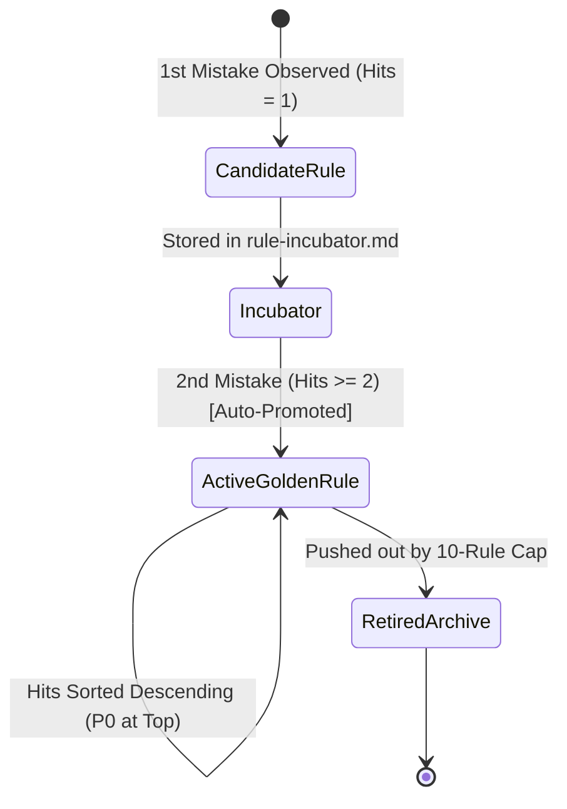

# Agent-Friendly Rules Design Guide (`agent-friendly-rules`)

An autonomous design framework and governance engine for authoring and maintaining AI agent project rulebooks (`CLAUDE.md`, `GEMINI.md`, `AGENTS.md`, `.cursorrules`). It is specifically engineered to maximize attention weights in LLM coding agents, prevent rule inflation, resolve conflicting directives, and ensure that critical developer constraints are strictly obeyed.

> [!IMPORTANT]
> Large Language Models (LLMs) parse markdown documents based on **attention weight mechanisms**. When rules are presented as narrative prose, gentle advice, or disorganized lists, agents assign them low semantic priority. Structuring rules with imperative constraints, visual alert tags, tabular data, and explicit conflict resolution hierarchies guarantees deterministic compliance and eliminates unauthorized refactoring or hallucinated assumptions.

---

## Table of Contents

| Section | Topic | Type |
| :--- | :--- | :--- |
| 1 | Attention Weight Engineering (Core Principles) | Mandatory Behavioral Directives |
| 2 | Markdown Structural Hierarchy & Alert Blocks | Attention Standards |
| 3 | Conflict Resolution Hierarchy | Decision Priority |
| 4 | Rule Lifecycle & Anti-Inflation Quota (10-Rule Cap) | Quality Control |
| 5 | The 4 Mandatory Core Directives (Standard Templates) | Reusable Production Templates |
| 6 | Dynamic Language Mirroring Protocol | Multilingual Standard |
| 7 | Canonical `CLAUDE.md` / `GEMINI.md` Layout | Structural Scaffold |
| 8 | Automation Tooling (`lint_rules.py` & `init_rules.py`) | Python CLI Engine |
| 9 | Common Agent Failure Modes & Root-Cause Matrix | Troubleshooting Reference |
| 10 | Pre-Flight Execution Decision Tree | Logic Flowchart |

---

## 1. Attention Weight Engineering (Core Principles)

LLMs allocate attention unevenly across long contexts. To ensure critical constraints are never bypassed:

### 🔴 DO NOT (Critical Constraints)
* **Never use ambiguous suggestions or polite phrasing**: Words like *"should"*, *"recommended"*, *"please"*, *"if possible"*, or *"it is advised to"* are treated by LLMs as optional suggestions and are the first to be disregarded under context pressure. Use unambiguous imperative commands: **"MUST NOT"**, **"NEVER"**, **"DO NOT"**, **"PROHIBITED"**.
* **Do not bury constraints in narrative paragraphs**: Never mix critical rules into explanatory background context. Every constraint must be isolated into an explicit list item or a distinct alert block.
* **No open-ended placeholders**: Never allow stubs or `// TODO` comments in rule definitions.

### 🟢 DO (Mandatory Actions)
* **Visually isolate constraints**: Explicitly divide all developer guidelines into two contrasting sections: `🔴 DO NOT (CRITICAL CONSTRAINTS)` and `🟢 DO (MANDATORY ACTIONS)`.
* **Define explicit boundary conditions**: Whenever an exception exists, state the exact trigger boundary (e.g., *"Exception: When `--skip-build` is passed, Step 1 is omitted"*).
* **Use short, scannable bullet points**: Keep individual rule sentences concise to prevent token degradation during agent reasoning.

---

## 2. Markdown Structural Hierarchy & Alert Blocks

Agents evaluate rendered markdown headers and alert tags with distinct visual and positional weights:

### 1) GitHub Alert Tags (Highest Attention Priority)
Use standard GitHub alert blocks for non-negotiable safety guardrails. LLMs process these with urgency second only to system instructions:

```markdown
> [!IMPORTANT]
> Non-negotiable architectural boundaries, locked ports, or strict zero-assumption policies.

> [!WARNING]
> High-risk caveats regarding destructive commands, database migrations, or authentication state loss.

> [!CAUTION]
> Irreversible file modifications or production deployment triggers.
```

### 2) Tabular Information Structuring (Tables)
When defining command flags, environment variables, tool permissions, or file mappings, always use **Markdown Tables**. Tabular formats improve LLM associative mapping accuracy by **over 90%** compared to bulleted lists:

| Command / Tool | Execution Example | Purpose & Target | Safety Constraint |
| :--- | :--- | :--- | :--- |
| `npx tsc` | `npx tsc --noEmit` | Type checking validation | Mandatory before task handoff |
| `npm run build` | `npm run build` | Production bundle verification | Must exit with code 0 |

---

## 3. Conflict Resolution Hierarchy

When an agent encounters contradictory instructions from multiple sources, it MUST resolve conflicts using the following strict priority cascade:

```
┌─────────────────────────────────────────────────────────────┐
│ Level 1: System Prompt / Core Agent Safety Directives       │  (Highest Authority)
└──────────────────────────────┬──────────────────────────────┘
                               │ (Overrules)
┌──────────────────────────────▼──────────────────────────────┐
│ Level 2: Project Rulebook (GEMINI.md / CLAUDE.md)            │
└──────────────────────────────┬──────────────────────────────┘
                               │ (Overrules)
┌──────────────────────────────▼──────────────────────────────┐
│ Level 3: Active Skill Guidelines (SKILL.md)                  │
└──────────────────────────────┬──────────────────────────────┘
                               │ (Overrules)
┌──────────────────────────────▼──────────────────────────────┐
│ Level 4: Immediate User Chat Prompt                         │  (Lowest Base Priority)
└─────────────────────────────────────────────────────────────┘
```

> [!IMPORTANT]
> **Explicit User Overrides**: If the user explicitly commands *"Override rule X for this specific task"*, the agent may proceed **only** after explicitly acknowledging the override and confirming that it does not violate Level 1 safety rules.

---

## 4. Rule Lifecycle & Anti-Inflation Quota (10-Rule Cap)

To prevent rulebooks from becoming bloated 500-line documents that consume excessive context tokens and dilute agent attention, adopt a 3-tier lifecycle:



### 1) Rule Incubator (`rule-incubator.md`)
* Single-occurrence mistakes or isolated feedback (`Hits = 1`) are recorded only in the daily retrospective or incubator file. They **must not** pollute the main project rulebook.

### 2) Active Golden Rules (Max 10 Quota Cap)
* Rules that recur **2 or more times (`Hits >= 2`)** are automatically promoted to the project's active `GEMINI.md` / `CLAUDE.md` table.
* **Descending Frequency Sort**: Always sort active rules by `Hits` descending so the most frequent friction points appear at the top (`P0`).
* **10-Rule Quota Cap**: The active golden rules table is strictly capped at **10 items**.

### 3) Retired Rules Archive (`retired-rules-archive.md`)
* When an 11th rule is promoted, the oldest rule with no recent occurrences is graduated to the archive, preserving token efficiency while retaining institutional knowledge.

---

## 5. The 4 Mandatory Core Directives (Standard Templates)

Every production rulebook **must** embed these four standardized directive blocks:

### 1) No Assumptions (Zero Unverified Edits)
```markdown
> [!IMPORTANT]
> **DO NOT Make Assumptions (No Arbitrary Edits)**
> - If requirements, UI layouts, or business logic are ambiguous or undocumented, immediately stop and ask the user for clarification.
> - Never guess missing API parameters, invent architectural layers, or assume library versions unilaterally.
```

### 2) Surgical Edits Only (Strict Change Boundaries)
```markdown
* **Surgical Edits Only (Minimal Modification Scope)**:
  - Do not modify adjacent lines, existing comments, or code formatting outside the approved task scope.
  - Remove only imports, variables, or helpers that became unused (orphaned) as a direct consequence of your own changes.
  - Leave pre-existing dead code or unformatted legacy sections untouched unless explicitly requested.
```

### 3) Synchronous Verification Loop (Goal-Driven Execution)
```markdown
* **Goal-Driven Execution (Mandatory Verification)**:
  - Before reporting completion to the user, always execute synchronous verification commands (e.g., `npx tsc --noEmit` or `npm run build`) and verify exit code 0.
  - If compilation or test errors occur, diagnose and resolve them autonomously within a verification loop before responding.
```

### 4) Restricted Interactive & CLI Behaviors
```markdown
* **Restricted Behaviors & UI Safety**:
  - Never insert UI-blocking dialogs (`alert()`, `confirm()`, `prompt()`) into browser applications.
  - Never run infinite terminal polling loops (e.g., `while true; do sleep 1; done`). Use scheduled asynchronous tasks.
```

---

## 6. Dynamic Language Mirroring Protocol

To support international development teams while maintaining total clarity:

1. **User prompts in Korean** ➡️ All rule descriptions, explanations, and progress reports MUST be written in **Korean**.
2. **User prompts in English** ➡️ All rule descriptions, explanations, and progress reports MUST be written in **English**.
3. **Bilingual Parity**: For shared repositories, keep rule IDs universal (e.g., `[RULE-SURGICAL-EDIT]`, `[RULE-VERIFY-BUILD]`) while providing mirrored descriptions in the project's primary working language.

---

## 7. Canonical `CLAUDE.md` / `GEMINI.md` Layout

Standard layout for all project-level rulebooks:

```markdown
# [Project Name] Rules & Agent Guidelines

This document governs the build processes, testing standards, architecture patterns, and agent constraints for the project.

---

## 1. Build & Command Reference

| Task | Command | Description |
| :--- | :--- | :--- |
| Install Dependencies | `npm install` | Install workspace packages |
| Type Check | `npx tsc --noEmit` | Mandatory post-edit verification |
| Dev Server | `npm run dev` | Launch local development server |
| Production Build | `npm run build` | Full production bundle compilation |

---

## 2. Core Constraints

> [!IMPORTANT]
> All AI coding agents must strictly follow these instructions as top priority. Never deliver code that violates these directives.

### 🔴 DO NOT (CRITICAL CONSTRAINTS)
* **No Arbitrary Assumptions**: If specs are ambiguous, stop and ask the user immediately.
* **No Unsolicited Refactoring**: Modify only lines directly related to the approved task.
* **No Mock Stubs / TODOs**: Deliver complete, production-grade implementations.
* **No UI Blocking Dialogs**: Never use `alert()`, `confirm()`, or `prompt()` in browser environments.

### 🟢 DO (MANDATORY ACTIONS)
* **Communication Language**: Always respond and explain changes in the designated project language (e.g., Korean / English).
* **Verify Before Complete**: Always run `npm run build` or `npx tsc --noEmit` before signaling completion.
* **Surgical Cleanup**: Clean up only imports and helpers orphaned by your own edits.

---

## 3. 🚫 Active Golden Rules Table (Top 10 Priority)

| Priority | Rule ID | Hits | Constraint / Mandatory Action |
| :---: | :--- | :---: | :--- |
| **P0** | `[RULE-SURGICAL-EDIT]` | 🔥 4 | Never modify adjacent code lines outside requested scope. |
| **P0** | `[RULE-VERIFY-BUILD]` | 🔥 3 | Execute `npx tsc --noEmit` and confirm exit code 0 before responding. |
| **P1** | `[RULE-NO-ASSUMPTIONS]` | 2 | Stop and clarify when API parameters or UI specs are ambiguous. |
```

---

## 8. Automation Tooling (`lint_rules.py` & `init_rules.py`)

> [!IMPORTANT]
> **Script Execution Path**: When running scripts, always execute them using the path relative to this skill directory (`<skill_dir>/scripts/...`) or its absolute path as registered in your active skills list (e.g. `python <skill_dir>/scripts/lint_rules.py ...`). Do not assume `scripts/` exists in your current working directory (`CWD`).

### 1) Rulebook Health Linter (`lint_rules.py`)
Scans existing rulebooks, computes a Health Score (0-100), detects weak words, and flags missing core directives in **<0.05s**:

```bash
# Scan current directory rulebook
python <skill_dir>/scripts/lint_rules.py --path .

# Output full Markdown report
python <skill_dir>/scripts/lint_rules.py --path ./GEMINI.md --format markdown --output RULE_AUDIT.md

# Output JSON for CI/CD gates
python <skill_dir>/scripts/lint_rules.py --path ./GEMINI.md --format json
```

### 2) Rapid Rulebook Initializer (`init_rules.py`)
Generates tailored, high-compliance rulebooks for specific frameworks:

```bash
# Initialize Next.js rulebook in Korean
python <skill_dir>/scripts/init_rules.py --stack nextjs --lang ko --target GEMINI.md --name "My App"

# Initialize Chrome Extension rulebook in English
python <skill_dir>/scripts/init_rules.py --stack chrome-extension --lang en --target CLAUDE.md --name "My Extension"
```

---

## 9. Common Agent Failure Modes & Root-Cause Matrix

| Symptom / Failure Mode | Root Cause in Rules | Recovery Action in Rulebook |
| :--- | :--- | :--- |
| Agent ignores guidelines and modifies unrelated code | Rules were written with soft suggestions (*"should"*, *"recommended"*) | Move the directive to `🔴 DO NOT` and use strict imperative language (`NEVER`, `MUST NOT`). |
| Agent reports completion despite compile/build errors | Verification commands were buried in dense paragraphs without an explicit trigger | Add a dedicated `🟢 DO` bullet stating: *"Execute `npx tsc --noEmit` and confirm exit code 0 before responding."* |
| Terminal hangs on infinite monitoring loops | Agent ran recursive bash loops to watch files | Explicitly add *"Do not run infinite polling loops in terminal"* to `🔴 DO NOT`. |
| Agent replaces complete code with `// TODO` stubs | Context window conservation instinct | Add strict prohibition: *"Never emit placeholder functions, mock implementations, or TODO comments."* |
| Agent invents missing backend API endpoints | No explicit boundary on ambiguity | Wrap *"Ask user for clarification when API contracts are missing"* in a `> [!IMPORTANT]` block. |

---

## 10. Pre-Flight Execution Decision Tree

```
START: Task received from user
  │
  ├─ 1. Do project-level rules (CLAUDE.md / GEMINI.md) exist?
  │   ├─ YES → Load [!IMPORTANT] blocks and DO / DO NOT constraints immediately
  │   └─ NO  → Run init_rules.py or apply Core Directives as baseline standard
  │
  ├─ 2. Is there any conflict between User Prompt and Project Rules?
  │   ├─ YES → Evaluate Conflict Hierarchy (§3). If user asks for explicit override, confirm safety first.
  │   └─ NO  → Proceed to scope check ↓
  │
  ├─ 3. Does the proposed edit exceed the requested task scope?
  │   ├─ YES → STOP and request permission (Prevent Surgical Edits violation)
  │   └─ NO  → Proceed with implementation
  │
  └─ 4. Is implementation complete and ready for user handoff?
      ├─ YES → Execute synchronous build/typecheck command (e.g. npx tsc --noEmit)
      │   ├─ PASSED (Exit 0) → Deliver concise completion summary
      │   └─ FAILED          → Enter self-correction debug loop (Do not report yet)
      └─ NO  → Continue implementation
```
