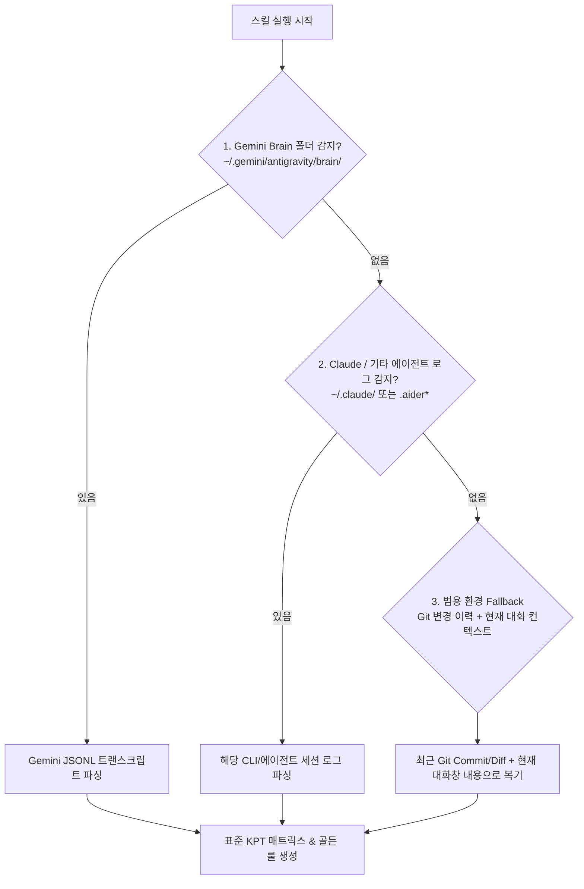
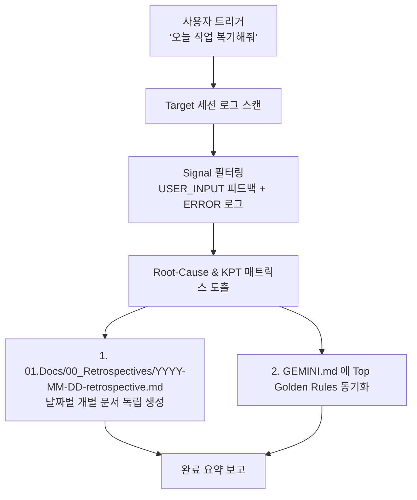

# 🧠 [기획서] session-retrospective (에이전트 세션 복기 및 지속적 학습 스킬)

> **목적**: Antigravity/Gemini 에이전트의 세션 대화 로그(`transcript.jsonl`) 및 시스템 실행 로그(`tasks/*.log`)를 분석하여, 성공 요인(Keep), 시행착오(Problem), 개선 행동 수칙(Golden Rule)을 초경량으로 구조화하고 프로젝트 룰에 피드백하는 **지속적 자가 학습(Continuous Learning) 스킬** 설계.

---

## 1. 배경 및 해결하려는 문제 (Problem Statement)

### 🚨 현상 및 문제점
1. **반복되는 동일 피드백/시행착오**:
   - 세션이 바뀌거나 대화가 길어지면 에이전트가 사용자의 이전 피드백(예: "다국어는 9개 전체 확인해", "여백 타이트하게 해")을 잊고 다시 같은 실수를 반복할 위험이 있음.
2. **원시 로그(Brain)의 비효율성**:
   - 에이전트 브레인 폴더(`brain/`)에 저장되는 원시 트랜스크립트는 수만 줄에 달하여, 이를 매번 처음부터 다시 읽는 것은 **심각한 토큰 낭비와 컨텍스트 오염**을 유발함.
3. **학습의 비체계성**:
   - 세션이 끝난 뒤 잘된 점과 잘못된 점을 공식적인 "오답 노트"로 축적하고 룰북에 자동 반영하는 표준화된 파이프라인 부재.

---

## 2. 핵심 목표 (Core Objectives)

- ⚡ **극단적 토큰 최적화**: 수만 줄의 원시 로그를 **200~300 토큰 내외의 정형화된 오답 매트릭스**로 고도로 압축.
- 🌐 **룰의 범용화 및 다국어 완벽 병기 (Bilingual Universal Rules)**:
  - 특정 프로젝트의 고유 명사(도메인 특화 변수명/기능명)를 직접 룰에 박지 않고, **어떤 프로젝트(웹, 앱, CLI, 백엔드)에서든 적용 가능한 보편적 엔지니어링/협업 원칙으로 추상화(Generalize)**.
  - **한국어(KO) 및 영문(EN) 100% 병기 체계**를 확립하여, 글로벌 협업 프로젝트 및 외국인 개발자 환경에서도 언어적 단절 없이 완벽 호환.
- 🎯 **에이전트 맞춤형 룰 생성**: 줄글/감상문 형태를 배제하고, 에이전트가 즉시 행동을 통제할 수 있는 **조건부 행동 수칙(Golden Rules)** 추출.
- 🔄 **2단계(2-Tier) 지식 이중화 & 날짜별 폴더 격리**:
  - **Tier 1 (상시 로드)**: 범용화된 최상위 핵심 룰 5~10줄을 룰북(`GEMINI.md`)에 즉시 반영하여 다음 대화 시 자동 준수.
  - **Tier 2 (날짜별 개별 문서)**: 복기 결과는 프로젝트의 `01.Docs/00_Retrospectives/YYYY-MM-DD-retrospective.md`로 **독립된 날짜별 파일**로 생성되어 가독성과 핀포인트 조회를 극대화.

---

## 3. 크로스 에이전트 세션 데이터 명세 & 3단계 자동 감지 (Cross-Agent Auto-Detection)

> 💡 **핵심 목표**: Gemini(Antigravity)뿐만 아니라 Claude Code, Cursor, Aider 등 **어떤 AI 에이전트 환경에서 실행하더라도 100% 정상 작동**하도록 다중 에이전트 감지 및 Fallback 체계를 갖춥니다.

### 🌐 환경별 세션/브레인 저장 경로 매핑

| AI 에이전트 환경 | 세션 로그 / 트랜스크립트 저장 위치 | 감지 및 파싱 방법 |
| :--- | :--- | :--- |
| **1. Gemini / Antigravity** | `~/.gemini/antigravity/brain/<conversation-id>/` | `transcript.jsonl`, `tasks/` 파일 직접 파싱 |
| **2. Claude Code** | `~/.claude/history/`, `~/.claude/sessions/` | `.claude` 디렉터리 내 JSON/세션 로그 파싱 |
| **3. Aider / Cline / Roo** | `.aider.chat.history.md` 또는 확장 스토리지 | 프로젝트 루트 내 `.aider*` 히스토리 파싱 |
| **4. Cursor / Windsurf / 기타** | IDE 워크스페이스 스토리지 또는 현재 컨텍스트 | **Git 커밋/Diff 로그 + 현재 대화 컨텍스트 분석** (Fallback) |

---

### 🛡️ 3단계 자동 감지 & Fallback 파이프라인



1. **Level 1 (Gemini / Antigravity)**: `~/.gemini/antigravity/brain/` 내 `transcript.jsonl` 및 `tasks/*.log` 정밀 파싱.
2. **Level 2 (Claude Code / Aider)**: `~/.claude/` 또는 프로젝트 내 `.aider.chat.history.md` 탐색 파싱.
3. **Level 3 (범용 Fallback - 모든 AI 지원)**:
   - 전용 로그 파일이 없는 환경(Cursor, Windsurf 등)에서는 **`git log -n 5 --stat` (최근 커밋 및 파일 변경 내역)**과 **현재 대화 컨텍스트**를 종합 분석하여 복기 수행.

---

### 🔍 추출하는 3대 핵심 신호 (Key Signals)
1. **사용자 정정 신호 (User Corrections)**:
   - 사용자가 *"이것도 해줘"*, *"이거 빠졌잖아"*, *"아니 그게 아니라"* 등의 피드백을 준 직전 에이전트 응답 분석.
2. **도구/빌드 실패 신호 (Execution Failures)**:
   - `tasks/*.log` 또는 터미널의 컴파일 에러, 문법 에러, 린트 에러 원인 분석.
3. **성공적 패턴 신호 (Best Practices)**:
   - 한 번에 에러 없이 빌드를 통과하고 사용자 요구를 정확히 만족시킨 설계 패턴 분석.

---

## 4. 스킬 작동 파이프라인 (Execution Workflow)



### 단계별 상세 로직
1. **Step 1: 대상 세션 식별 (Identify Session)**
   - 사용자가 날짜를 지정한 경우(`2026-08-17`) 해당 날짜의 conversation transcript를 타겟팅.
   - 미지정 시 현재 활성 세션(Current Session)의 로그를 타겟팅.
2. **Step 2: 경량 필터링 (Lightweight Filtering)**
   - 전체 로그를 무식하게 읽지 않고, `type: USER_INPUT`과 `status: ERROR` 및 `task-*.log`의 끝부분 에러 라인만 선별 추출.
3. **Step 3: KPT & Golden Rule 도출 (Rule Synthesis)**
   - **Keep**: 성공적이었던 아키텍처/작업 방식.
   - **Problem**: 헛다리 짚은 원인 및 누락 발생 이유.
   - **Try / Golden Rule**: 다음 작업에서 무조건 지켜야 할 단일 행동 규칙.
4. **Step 4: 날짜별 문서 생성 & 룰 동기화 (Dual-Layer Sync)**
   - **저장 폴더 자동 감지 (Output Directory Resolution)**:
     - 사용자가 특정 폴더를 명시한 경우: 해당 지정 경로에 저장.
     - 사용자가 폴더를 지정하지 않은 경우 (기본): 프로젝트 내 문서 디렉토리 우선순위 자동 감지:
       1. `01.Docs/00_Retrospectives/` (프로젝트에 `01.Docs` 존재 시)
       2. `docs/retrospectives/` (프로젝트에 `docs` 존재 시)
       3. `docs/retrospectives/` (둘 다 없을 경우 기본 생성)
   - **날짜별 전용 문서 생성**: `<resolved_dir>/YYYY-MM-DD-retrospective.md` 파일로 독립 저장 (날짜별 히스토리 격리).
   - **폴더 인덱스(README.md) 갱신**: `<resolved_dir>/README.md`에 날짜별 링크 및 요약 1줄 자동 색인.
   - **프로젝트 룰북 동기화**: 범용화된 골든 룰 1~2줄을 프로젝트 룰북에 즉시 반영.

---

## 5. 룰 범용화 및 추상화 가이드라인 (Rule Generalization Guidelines)

> ⚠️ **핵심 원칙**: 룰북에 피드백할 때 특정 프로젝트에 종속적인 고유명사를 직접 쓰지 않고, **다른 프로젝트(웹, 앱, 백엔드 등)에서도 재사용 가능한 보편적 엔지니어링 원칙**으로 승격(Generalize)합니다.

### 🔄 프로젝트 종속 룰 ➡️ 범용 골든 룰 변환 예시

| 구분 | ❌ 프로젝트 종속적 룰 (나쁜 예) | 🟢 범용화된 골든 룰 (좋은 예) |
| :--- | :--- | :--- |
| **다국어/문서 동기화** | "Pomogochi 스토어 문서 5개만 수정하지 말고 9개 다 수정해라." | **[RULE-I18N-SYNC]** 다국어(i18n) 및 리소스/문서 수정 시, 프로젝트에 정의된 전체 로케일(Locale) 목록을 먼저 파싱하고 1:1 전수 일괄 동기화한다. |
| **명칭/용어 변경** | "대시보드의 Diary를 Buddy Notes로 바꿔라." | **[RULE-TERMINOLOGY-REF]** 핵심 기능 명칭이나 용어를 변경할 때는 네비게이션, 위젯, 문서, 알림 메시지까지 전체 영향 범위를 사전 식별하고 일괄 갱신한다. |
| **UI/여백 정밀도** | "버디 방꾸미기 팝업 여백 줄여라." | **[RULE-UI-PRECISION]** 모달 및 카드 UI 구현 시 붕 뜨는 여백을 배제하고, 고밀도 컴팩트 레이아웃과 5px 슬림 스크롤바를 기본 적용한다. |
| **코드 수정 범위** | "diary-view.tsx 주변 코드 건드리지 마라." | **[RULE-SURGICAL-EDIT]** 기존 코드 수정 시 최소 변경 대상 라인만 외과수술식(Surgical)으로 수정하며, 인접한 무관한 코드를 임의로 리팩토링하지 않는다. |

---

## 6. 룰 비대화 방지 및 빈도 기반 승격/정렬 시스템 (Anti-Inflation & Weighted Promotion)

> 💡 **핵심 목표**: 사소한 1회성 이슈로 룰북이 비대해지는 것(Rule Bloat)을 방지하고, **자주 반복되는 중요한 실수일수록 상단에 강조 및 높은 우선순위로 정렬**되도록 통제합니다.

### 🛡️ 3대 룰 품질 제어 장치 (Quality Control Mechanisms)

```mermaid
flowchart TD
    A[세션 복기 분석] --> B{과거 동일 실수<br/>반복 여부 체크}
    B -- "1회성 발생 (Hits = 1)" --> C[날짜별 개별 문서에만 기록<br/>'후보 룰(Candidate Rule)' 보관<br/>※ 메인 룰북에는 안 넣음]
    B -- "2회 이상 반복 (Hits >= 2)" --> D[메인 룰북 GEMINI.md 로 자동 승격<br/>'🔥 Golden Rule' 등록]
    D --> E[빈도수(Hits) 내림차순 정렬<br/>가장 많이 반복된 룰이 최상단 배치]
    E --> F{룰북 총량 7개 초과?}
    F -- "Yes" --> G[가장 오래 재발 없는 하위 룰<br/>아카이브로 자동 졸업/이동]
    F -- "No" --> H[룰북 유지 완료]
```

1. **승격 임계값 (Promotion Threshold)**:
   - **1회성 실수 (`Hits = 1`)**: 날짜별 회고 문서(`YYYY-MM-DD-retrospective.md`)에만 '후보 룰(Candidate)'로 남기고 메인 룰북에는 추가하지 않음.
   - **2회 이상 재발 (`Hits >= 2`)**: 비로소 `GEMINI.md`의 [에이전트 골든 룰] 테이블로 자동 승격(Promote).
2. **빈도 기반 가중치 및 자동 정렬 (Frequency-Weighted Sorting)**:
   - 룰 테이블에 **`발생 횟수(Hits)`** 및 **`중요도 뱃지`**를 표기.
   - **반복 횟수가 높은 순서(Hits 내림차순)**로 항상 최상단에 자동 정렬하여 에이전트의 시각적/인지적 주의를 집중시킴.
     - `🔥 [3회]`: 최우선 핵심 주의 룰
     - `⚠️ [2회]`: 주의 룰
3. **룰북 정원제 (Rule Quota Cap - 최대 10개)**:
   - `GEMINI.md`에 상주하는 골든 룰의 개수를 **최대 10개 이내로 고정**.
   - 새로운 룰이 들어와 10개를 초과하면, 최근 5회 이상 재발하지 않은 가장 낮은 빈도의 룰은 `01.Docs/00_Retrospectives/README.md` 아카이브로 '졸업(Retire)' 이동.
4. **무결점 세션 시 억지 규칙 생성 금지 (Clean Session & No-Op Principle)**:
   - 모든 작업이 실수나 정정 없이 원활하게 끝난 날에는 **억지로 사소한 규칙을 지어내서 적는 강박을 철저히 배제**.
   - 개선할 만한 반복 실수가 없으면 `✨ Clean Session (룰북 변경 없음)`으로 선언하고 룰북을 전혀 건드리지 않고 그대로 유지.

---

### ✍️ 룰북 작성 5대 표준 문법 & 지시 언어 일치 (Canonical Grammar & Language Mirroring)

두서없는 문장이나 중구난방 텍스트가 삽입되는 것을 방지하기 위해, 룰북에 기록되는 문장은 **단 하나의 엄격한 문법 규격**만 허용합니다:

1. **지시 언어 동적 일치 (Dynamic Language Mirroring)**:
   - 사용자가 지시한 언어와 100% 동일한 언어로 행동 규칙 및 문서를 작성합니다.
   - 한국어 지시 (예: *"오늘 작업 복기해줘"*) ➡️ 행동 규칙을 **한국어**로 정제하여 기록.
   - 영어 지시 (예: *"Review today's session"*) ➡️ 행동 규칙을 **영어**로 정제하여 기록.
2. **룰 코드 명명법**: `RULE-[CATEGORY]-[ACTION]` (영문 대문자 스네이크 케이스로 전역 식별자 고정)
3. **표준 문장 구조 (When ➡️ Must Action ➡️ Prohibition)**:
   - 한국어: `[조건/상황: When] 시 [필수 행동: Must Action]하며 [금지 사항: Prohibition]을 금지한다.`
   - 영어: `When [Condition/Trigger], always [Must Action] and avoid [Prohibition].`
4. **글자 수 엄격 제한**: 한눈에 파악할 수 있도록 **공백 포함 90자 이내(영문 140자 이내)의 단문 1문장**으로 제한 (장황한 설명/철학적 사족 배제).
5. **격리 구역 고정 (Isolation Zone)**: 룰북 내 임의의 위치에 줄글로 작성하지 않고, 오직 `### 🚫 REFINED AGENT GOLDEN RULES` 전용 테이블의 1개 행(Row)으로만 삽입.

---

### 📊 룰북(`GEMINI.md`) 반영 시 표준 테이블 포맷 예시

```markdown
## 🚫 Agent Golden Rules (빈도 정렬 오답노트 Top 10)
| 우선순위 | 룰 코드 | 발생 빈도 | 범용 행동 수칙 (Golden Rule) |
| :---: | :--- | :---: | :--- |
| **P0** | `RULE-I18N-SYNC` | 🔥 **3회** | 다국어/리소스 수정 시 프로젝트 정의 전체 로케일(Locale) 목록과 1:1 전수 일괄 동기화 |
| **P1** | `RULE-SURGICAL-EDIT` | ⚠️ **2회** | 코드 수정 시 최소 변경 대상 라인만 외과수술식으로 수정하며 인접 코드 임의 변경 금지 |
| **P1** | `RULE-TERMINOLOGY-REF`| ⚠️ **2회** | 기능 명칭 변경 시 네비게이션, 위젯, 문서, 알림 메시지까지 영향 범위를 사전 식별하고 일괄 갱신 |
```

---

## 7. 4대 고도화 시스템 설계 (Advanced Enhancement Suite)

> 💡 **핵심 목표**: 단순 복기를 넘어, 페어 프로그래밍 생산성 정량화, 체화된 룰 보존, 작업 제출 전 자가 검증, 그리고 기간별 총평 롤업까지 **에이전트 인텔리전스를 극대화**합니다.

### 🌟 4대 고도화 기능 명세

1. **📊 세션 건강도 점수 (`Session Health Score - 0~100점`)**:
   - 사용자 정정 요청 횟수(`friction_points`)와 빌드 에러 횟수(`errors`)를 종합 계산하여 점수화.
   - 등급 분류: `🌟 Excellent (90~100점)`, `🟢 Good (80~89점)`, `🟡 Moderate (70~79점)`, `⚠️ Needs Alignment (<70점)`
   - 산출물 상단에 `- **세션 건강도**: 🌟 **95점** (Excellent Alignment)` 자동 표기.

2. **🎓 졸업한 룰 명예의 전당 아카이브 (`Retired Rules Hall of Fame`)**:
   - 10개 정원제(Cap)로 인해 밀려난 룰들을 삭제하지 않고 `01.Docs/00_Retrospectives/README.md` 하단에 「🎓 졸업한 골든 룰 아카이브」 테이블로 자동 보관.
   - 완전히 체화되어 극복한 과거 실수의 성장 히스토리를 영구 보존.

3. **🛡️ 프리플라이트 셀프 검증 모드 (`Pre-Flight Self-Audit Mode`)**:
   - 작업 완료 보고 직전, `manage_rules.py --audit`를 통해 현재 활성 골든 룰을 `[ ] 체크리스트` 형태로 출력하여 에이전트가 3초간 위반 여부를 셀프 점검.

4. **📈 주간/월간 회고 종합 롤업 리포트 (`Weekly/Monthly Rollup Engine`)**:
   - `generate_retro_doc.py --rollup weekly` 실행 시 최근 일주일간의 회고 문서를 자동 스캔하여 `rollup-weekly-YYYY-MM-DD.md` 1페이지 종합 총평 보고서 생성.

5. **🚀 1-Stop 원스톱 파이프라인 & Windows UTF-8 안정화 (`One-Stop Auto Pipeline & Encoding Shield`)**:
   - `generate_retro_doc.py --auto` 또는 `--stdin`을 통해 `parse_session.py` 파싱 결과로부터 통계, 토큰 메트릭, 그리고 추천 KPT(`suggested_kpt`) 초안을 자동 흡수하여 단 한 번의 커맨드로 복기 문서를 완전 생성.
   - Windows 터미널의 `cp949` 인코딩 충돌을 방어하기 위해 모든 스크립트 입출력에 `reconfigure(encoding="utf-8", errors="replace")` 및 표준 에러 대체 로직을 100% 내재화.

---

## 8. 초경량 복기 산출물 표준 템플릿 (Standard Template)

```markdown
# 📅 [YYYY-MM-DD] 세션 복기 및 오답노트

- **세션 주제**: (작업 주제 한 줄 요약)
- **작업 통계**: 수정 파일 N개, 빌드 검증 N회 (Pass)
- **세션 건강도**: 🌟 **95점** (Excellent Alignment)
- **토큰 최적화**: 원시 로그 523 KB (~130,000 토큰) ➡️ 정제 다이제스트 1.8 KB (~450 토큰, 99.7% 절감)
- **대상 에이전트**: Gemini Antigravity

---

### 🎯 복기 매트릭스 (KPT)
| 구분 | 내용 | 분석 및 근본 원인 |
| :--- | :--- | :--- |
| **Keep (성공)** | 성공 요인 및 Best Practice | (성공 요인 요약) |
| **Problem (실수)** | 사용자 정정 및 누락 원인 | (근본 원인 분석) |
| **Try (실행 수칙)** | 앞으로 무조건 적용할 행동 수칙 | (구체적 실행 방안) |

---

### 🚫 추출된 행동 룰 (Rule Extraction)
- **룰 코드**: `RULE-XXXX`
- **상태**: 🔥 **승격 (`GEMINI.md` 동기화)** 또는 💡 후보 룰 (Hits=1 보관)
- **행동 수칙**: [조건] 시 [필수 행동]하며 [금지 사항]을 금지한다.
```

---

## 9. 최종 스킬 디렉터리 구성

```text
📁 C:\00_Workspace\00_Module_Dev\00_스킬개발\session-retrospective\
├── 📄 README.md                 # 영문 공식 설명서 및 CLI 가이드
├── 📄 PLANNING.md               # [현재 문서] 전체 아키텍처 및 기획 설계서
├── 📄 SKILL.md                  # AI 에이전트 실행 프로토콜 지침서
└── 📁 scripts/                  # 3대 고속 파이썬 보조 엔진
    ├── 🐍 parse_session.py       # 원시 로그 파서, 마찰 지점 추출 및 토큰/건강도 계산기
    ├── 🐍 manage_rules.py        # Hits 카운터, 정렬기, 7개 캡 제어기, 명예의 전당 & 셀프 검증기
    └── 🐍 generate_retro_doc.py  # 날짜별 회고 문서, README 색인 & 주간/월간 롤업 생성기
```
