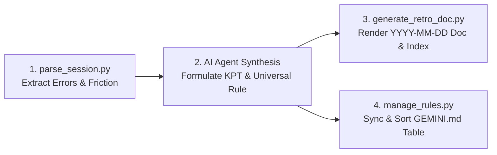

# Agent Session Retrospective Skill (`agent-session-retrospective`)

An autonomous post-mortem and continuous learning engine for AI pairing sessions. It extracts friction points, build failures, and best practices from session logs, produces a date-isolated retrospective document, and synchronizes generalized Golden Rules into the project rulebook (`GEMINI.md` / `CLAUDE.md`).

---

## 1. When to Activate

Trigger this skill whenever the user requests:
- *"오늘 작업 복기해줘"* / *"오늘 세션 회고해줘"*
- *"2026-08-17 복기해서 오답노트에 남겨줘"*
- *"Review and summarize today's session post-mortem"*
- *"Extract lessons and update golden rules from recent mistakes"*

---

## 2. Core Operational Philosophy

1. **Ultra-Compact Token Efficiency**: Never dump raw transcripts. Use helper scripts to filter signals into a 300-token digest.
2. **Universal Rule Generalization**: Never store project-specific domain names in global rules. Abstract every lesson into a universal software engineering/collaboration principle (e.g., `[RULE-I18N-SYNC]`, `[RULE-SURGICAL-EDIT]`).
3. **No Forced Rules (억지 규칙 생성 금지)**:
   - **Never force-create artificial rules** when a session went smoothly with zero friction or build errors.
   - If there is no recurring mistake or critical lesson, explicitly declare `Clean Session (No-Op)` and leave the rulebook untouched.
4. **Anti-Rule Bloat (Quality Control)**:
   - **Hits = 1**: Store in `rule-incubator.md` as a **Candidate Rule** (do not pollute the main rulebook).
   - **Hits >= 2**: Automatically promote to the main rulebook's `### 🚫 REFINED AGENT GOLDEN RULES` table.
   - **Descending Frequency Sort**: Always sort rules by `Hits` descending so the most frequent errors appear at the top (`P0`).
   - **Rule Cap (Max 10)**: Keep the active table under 10 rules. Retire older non-recurring rules to standalone `retired-rules-archive.md`.
5. **Dynamic Language Mirroring (지시 언어 100% 일치 원칙)**:
   - **User prompts in Korean** ➡️ All rule descriptions, candidate items, and retrospective docs MUST be written in **Korean**.
   - **User prompts in English** ➡️ All rule descriptions, candidate items, and retrospective docs MUST be written in **English**.
   - **User prompts in Japanese** ➡️ All rule descriptions, candidate items, and retrospective docs MUST be written in **Japanese**.
6. **Date-Isolated Folder Output**: Default to `<project_root>/01.Docs/00_Retrospectives/YYYY-MM-DD-retrospective.md` (or `docs/retrospectives/`) with an automatic `README.md` index.

---

## 3. Step-by-Step Execution Protocol



### Step 1. Ingest Session Signals (Ultra-Fast Python Parse)
Run the log parser script from the project's skill directory using relative paths:

```bash
# Option A: Parse specific date (default: today / latest)
python .agents/skills/agent-session-retrospective/scripts/parse_session.py --date <YYYY-MM-DD> --format json

# Option B: Parse past N days (e.g. past week = --days 7)
python .agents/skills/agent-session-retrospective/scripts/parse_session.py --days 7 --format json

# Option C: Parse since specific date (e.g. --since 2026-08-10) with workspace filter
python .agents/skills/agent-session-retrospective/scripts/parse_session.py --since <YYYY-MM-DD> --filter-workspace --format json
```

*Note: If no arguments are provided, it parses all sessions from today.*

### Step 2. KPT & Root-Cause Synthesis
From the parsed output or `suggested_kpt` block, formulate/refine the KPT matrix:
- **Keep (Success)**: What went cleanly on the first try? (e.g., synchronous build verification, zero type errors).
- **Problem (Friction/Error)**: Where did the user have to intervene or where did builds fail? Identify the true root cause.
- **Try / Golden Rule**: Convert the problem into a universal, actionable behavior rule.

### Step 3. Generate Daily Retrospective Document (One-Stop Auto or Explicit)

```bash
# 🔥 Method 1: One-Stop Seamless Auto Generation (Recommended - Auto parses & renders)
python .agents/skills/agent-session-retrospective/scripts/generate_retro_doc.py --auto --date "<YYYY-MM-DD>"

# 🚀 Method 2: Pipeline with Custom Parameter Overrides (Single-line safe for Windows & Linux)
python .agents/skills/agent-session-retrospective/scripts/generate_retro_doc.py --date "<YYYY-MM-DD>" --topic "<Session Topic>" --keep "<Keep text>" --problem "<Problem text>" --try-rule "<Try action text>" --rule-code "<RULE-CODE>"

# 🛠️ Method 3: Direct Explicit Rendering with Full Stats
python .agents/skills/agent-session-retrospective/scripts/generate_retro_doc.py --date "<YYYY-MM-DD>" --topic "<Session Topic>" --keep "<Keep text>" --problem "<Problem text>" --try-rule "<Try action text>" --rule-code "<RULE-CODE>" --rule-text "<Universal rule description>" --rule-status "<promoted|candidate|none>" --files-count <N> --build-count <N> --build-status "Pass" --agent-name "AI Agent"
```

### Step 4. Candidate Incubation OR Golden Rule Promotion
- **Case A: Hits == 1 (Candidate Rule)** ➡️ Register into `rule-incubator.md`:
  ```bash
  python .agents/skills/agent-session-retrospective/scripts/manage_rules.py --code "<RULE-CODE>" --text "<Universal rule description>" --date "<YYYY-MM-DD>" --candidate --file "GEMINI.md"
  ```
  *(Note: If the script detects that this candidate already exists in `rule-incubator.md`, it will automatically promote it to `GEMINI.md`!)*

- **Case B: Hits >= 2 (Promoted Golden Rule)** ➡️ Sync into `GEMINI.md`:
  ```bash
  python .agents/skills/agent-session-retrospective/scripts/manage_rules.py --file "GEMINI.md" --code "<RULE-CODE>" --text "<Universal rule description>" --hits 1 --cap 10
  ```

### Step 5. Pre-Flight Self-Audit Mode (Optional Check)
Before delivering final code to the user, run a self-audit against active golden rules:

```bash
python .agents/skills/agent-session-retrospective/scripts/manage_rules.py --file "GEMINI.md" --audit
```

### Step 6. Weekly/Monthly Rollup Briefing (Optional Aggregate)
To generate a 1-page periodic rollup summary:

```bash
python .agents/skills/agent-session-retrospective/scripts/generate_retro_doc.py --rollup weekly
```

---

## 4. Rule Generalization & Toxic Anti-Pattern Mapping (Bilingual Reference)

| Domain / Anti-Pattern | 🚨 Bad AI Agent Anti-Pattern | 🟢 Good Universal Golden Rule (KO / EN) |
| :--- | :--- | :--- |
| **코드 무단 삭제/축소**<br/>*(Destructive Deletion)* | 확인 없이 기존 주석/방어 로직/함수를 날려버림<br/>*Deleting existing utilities, comments, or guards without asking* | **`[RULE-CODE-PRESERVATION]`**<br/>- 🇰🇷 기존 유틸리티, 함수, 주석, 방어 로직을 사용자 확인 없이 임의 삭제하거나 축소하지 않는다.<br/>- 🇺🇸 Never delete or shrink existing utilities, functions, comments, or guards without explicit confirmation. |
| **불필요한 인접 수정**<br/>*(Unsolicited Edits)* | 시키지 않은 주변 줄을 리팩토링하다 버그 유발<br/>*Arbitrarily refactoring adjacent lines and causing unintended regressions* | **`[RULE-SURGICAL-EDIT]`**<br/>- 🇰🇷 코드 수정 시 최소 변경 대상 라인만 외과수술식으로 수정하며 인접 코드 임의 변경을 금지한다.<br/>- 🇺🇸 Apply surgical edits strictly to minimal target lines and avoid arbitrary adjacent code modifications. |
| **가정 기반 독단 코딩**<br/>*(Arbitrary Assumptions)* | 모호한데 안 물어보고 혼자 멋대로 판단 구현<br/>*Guessing unclear requirements without presenting options to the user* | **`[RULE-NO-ASSUMPTIONS]`**<br/>- 🇰🇷 요구사항이나 UI 배치가 불명확할 때는 독단적으로 추측하여 코딩하지 않고 반드시 먼저 확인받는다.<br/>- 🇺🇸 Never guess ambiguous requirements; always present options and obtain clarification before coding. |
| **TODO/목업 방치**<br/>*(Lazy Placeholders)* | 나중에 하겠다고 // TODO 남기고 대충 껍데기 작성<br/>*Leaving lazy // TODO comments or dummy placeholders instead of complete code* | **`[RULE-NO-PLACEHOLDERS]`**<br/>- 🇰🇷 나중에 구현하겠다는 // TODO나 임시 플레이스홀더를 남기지 않고 즉시 완전한 제품 코드를 작성한다.<br/>- 🇺🇸 Never leave lazy // TODO or dummy placeholders; deliver complete, production-ready code immediately. |
| **동일 파일 뺑뺑이**<br/>*(File Thrashing)* | 한 파일을 4회 이상 뗐다 붙였다 반복 수정<br/>*Repeatedly modifying the same file back and forth 4+ times without impact analysis* | **`[RULE-ONE-PASS-PRECISION]`**<br/>- 🇰🇷 동일 파일을 반복 수정하지 않고, 사전 영향 범위를 완전히 분석한 뒤 1회에 정밀 수정한다.<br/>- 🇺🇸 Never thrash or edit the same file repeatedly; analyze full blast radius and execute with single-pass precision. |
| **i18n & 다국어 누락**<br/>*(i18n Omission)* | 전체 언어팩 중 일부 언어만 수정하고 완료 처리<br/>*Updating only a subset of language packs, leaving others missing or untranslated* | **`[RULE-I18N-SYNC]`**<br/>- 🇰🇷 다국어(i18n) 및 리소스 수정 시 프로젝트 정의 전체 로케일 목록을 선제 파싱하고 1:1 일괄 동기화한다.<br/>- 🇺🇸 Always parse the full project locale list before editing i18n resources to ensure 100% 1:1 parity. |
| **명칭 변경 누락**<br/>*(Terminology Drift)* | 기능 이름 바꾸면서 위젯/문서/알림 누락<br/>*Renaming features without updating references in navigation, widgets, docs, or alerts* | **`[RULE-TERMINOLOGY-REF]`**<br/>- 🇰🇷 기능 명칭 변경 시 네비게이션, 위젯, 문서, 알림 메시지까지 영향 범위를 사전 식별하고 일괄 갱신한다.<br/>- 🇺🇸 When renaming features, pre-identify and update all references across navigation, widgets, docs, and alerts. |

---

## 5. Mandatory Rule Syntax & Format Constraints

To prevent chaotic or verbose rule additions, every rule written to `GEMINI.md` / `CLAUDE.md` **MUST strictly follow this single canonical syntax**:

### 🎯 5-Part Canonical Rule Grammar & Language Mirroring
1. **Dynamic Language Mirroring (지시 언어 일치 원칙)**:
   - Always write the rule description and retrospective documents in the **same language used by the user's prompt**:
     - User prompts in **Korean** (e.g., *"오늘 작업 복기해줘"*) ➡️ Write the rule description and doc in **Korean**.
     - User prompts in **English** (e.g., *"Review today's session"*) ➡️ Write the rule description and doc in **English**.
     - User prompts in **Japanese** ➡️ Write the rule description and doc in **Japanese**.
2. **Rule Code Format**: Always `RULE-[CATEGORY]-[ACTION]` in **English uppercase** for global semantic indexing (e.g., `RULE-I18N-SYNC`, `RULE-SURGICAL-EDIT`).
3. **Standard Sentence Structure (When ➡️ Must Action ➡️ Prohibition)**:
   - Korean: `[조건/상황: When] 시 [필수 행동: Must Action]하며 [금지 사항: Prohibition]을 금지한다.`
   - English: `When [Condition/Trigger], always [Must Action] and avoid [Prohibition].`
4. **Length Constraint**: Strictly **under 90 Korean characters (or 140 English characters)** in a single crisp sentence. No multi-line ramblings.
5. **Isolation Zone**: Rules **MUST NEVER** be scattered as free text. Inserted exclusively as a single row in the designated Markdown Table (`### 🚫 REFINED AGENT GOLDEN RULES`) managed by `manage_rules.py`.

---

## 6. Output Verification
After executing the skill, verify:
1. `<output_dir>/<YYYY-MM-DD>-retrospective.md` exists and is formatted cleanly.
2. `<output_dir>/README.md` index contains the new entry in the top row.
3. If promoted, `GEMINI.md` contains the sorted Golden Rules table under 10 items without any formatting corruption.
4. Report a concise 3-bullet summary to the user in Korean.
