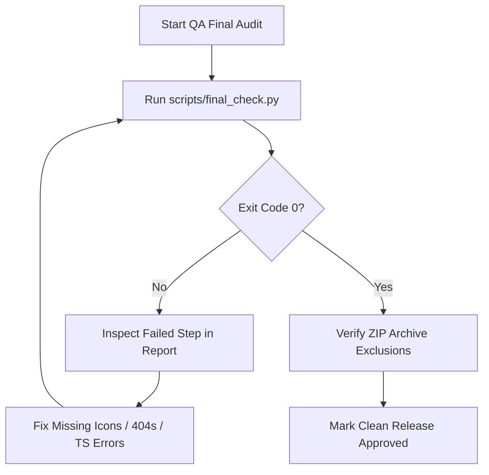

# 🛡️ Chrome Extension Project Final Checker (`chrome-extension-project-final-checker`)

An automated, rigorous **5-Step Deep Audit Protocol** and **Python QA Runner CLI (`final_check.py`)** for Chrome Extension Manifest V3 platforms and modern web applications prior to release. It ensures production stability, store policy compliance, runtime crash prevention, and zero-defect deployments.

> [!IMPORTANT]
> A successful local build does not guarantee a functioning Chrome extension. Silent failures—such as Service Workers dropping events after waking from idle sleep, `chrome.storage.sync` exceeding the 100KB quota, broken asset path case-sensitivity on Linux/Chrome OS, or missing event listener teardown—cause runtime crashes that only surface in production. This skill eliminates those silent failures before release.

---

## Table of Contents

| Section | Topic | Type |
| :--- | :--- | :--- |
| 1 | The 5-Step Deep Verification Protocol Overview | QA Architecture |
| 2 | Step-by-Step Deep Audit Procedures | Technical Verification |
| 3 | The 4 Silent Failure Diagnostics (MV3 Edge Cases) | Edge Case Prevention |
| 4 | Release Package & ZIP Integrity Protocol | Deployment Safety |
| 5 | Automation Tooling Reference (`final_check.py`) | Python CLI Engine |
| 6 | QA Approval Criteria & Decision Flowchart | Pass/Fail Gate |

---

## 1. The 5-Step Deep Verification Protocol Overview

```
                               ┌────────────────────────────────┐
                               │   5-Step Final Checker Engine  │
                               └───────────────┬────────────────┘
                                               │
         ┌───────────────────┬─────────────────┼─────────────────┬───────────────────┐
         ▼                   ▼                 ▼                 ▼                   ▼
     [ Step 1 ]          [ Step 2 ]        [ Step 3 ]        [ Step 4 ]          [ Step 5 ]
  Production Build      Manifest V3       Cross-Browser    Asset Integrity      Code Health &
    Verification        Compliance         & Shadow DOM      (404 Audit)        Memory Leaks
  (npm run build)    (Least Privilege)   (CSS Isolation)  (Path Resolvers)     (Cleanups & Lints)
```

| Step | Audit Category | Core Objective & Diagnostic Mechanism |
| :--- | :--- | :--- |
| **Step 1** | **Production Bundle Build Audit** | Execute `npm run build` and `npx tsc --noEmit` to verify bundling, module resolution, and chunk generation. |
| **Step 2** | **Manifest V3 & Store Compliance** | Validate `manifest.json` schema, Least Privilege permission scope, physical icon existence (16/48/128), and CSP. |
| **Step 3** | **Cross-Browser Compatibility & API Isolation** | Ensure W3C compliance across Chrome, Edge, Whale, Firefox, and Safari, verifying Shadow DOM style isolation. |
| **Step 4** | **Runtime Asset Integrity Audit (404 Audit)** | Audit existence of WebP/PNG images, MP3 audio, and dynamic asset URL resolvers (`getURL`) with case-sensitivity matching. |
| **Step 5** | **Code Health, Memory Leaks & Storage Quotas** | Verify event listener cleanup pairs, timer clearance, hook dependency arrays, and `chrome.storage` quotas. |

---

## 2. Step-by-Step Deep Audit Procedures

### Step 1: Production Bundle Build Audit
* **Command**: `npm run build`
* **Audit Items**:
  - Verify zero TypeScript compilation errors via `npx tsc --noEmit`.
  - Check Vite/Webpack bundler output for unresolved module imports or circular dependencies.
  - Confirm production distribution artifacts (`dist/` or `build/`) are generated with all required entry points (`index.html`, `background.js`, `content.js`, `popup.html`).

---

### Step 2: Manifest V3 & Store Policy Compliance Audit
* **Target Files**: `manifest.json` and `public/` directory
* **Audit Items**:
  - **Manifest Version**: Ensure `"manifest_version": 3` is specified and no deprecated V2 APIs are used.
  - **Icon Presence**: Validate the physical existence of `16x16`, `48x48`, and `128x128` PNG icons on disk.
  - **Permission Scope**: Enforce the Principle of Least Privilege and eliminate unreferenced permissions.
  - **Service Worker Registration**: Check `"service_worker"` script paths and confirm valid `type: "module"` configuration when ES modules are imported.

---

### Step 3: Cross-Browser Compatibility & API Isolation Audit
* **Target Browsers**: Chrome, MS Edge, Naver Whale, Firefox, Safari
* **Audit Items**:
  - **W3C Standard Polyfills**: Ensure `chrome.*` and `browser.*` API abstractions execute cleanly across all targets.
  - **Shadow DOM Style Isolation**: Confirm injected UI elements/widgets are encapsulated in Shadow Roots to prevent host website CSS bleeding and stylesheet conflicts.
  - **Graceful Fallbacks**: Ensure fallback mechanisms handle missing browser APIs gracefully without breaking main execution flows.

---

### Step 4: Runtime Asset Integrity Audit (404 & Path Resolver Audit)
* **Audit Items**:
  - **Dynamic Asset Resolution**: Verify all asset URLs injected into host pages use `chrome.runtime.getURL()`. Relative DOM paths in content scripts will fail to resolve.
  - **Image & Audio Integrity**:
    - Audit all referenced WebP, PNG, SVG, and MP3 files against 404 missing files.
    - Check case-sensitivity matching to prevent Linux/Chrome OS runtime asset failures (e.g., `icon.png` vs `Icon.png`).
  - **Fallback Handling**: Ensure UI elements handle image load errors (`onerror` fallbacks) gracefully.

---

### Step 5: Code Health, Memory Leak & Storage Quota Audit
* **Audit Items**:
  - **Unbound Event Listeners**: Ensure every `window.addEventListener` or `chrome.storage.onChanged.addListener` has a corresponding cleanup handler (`removeEventListener`).
  - **Timer & Interval Cleanup**: Verify `setInterval`, `setTimeout`, and `requestAnimationFrame` instances are cleared when components unmount.
  - **React Hook Optimization**: Audit `useMemo`, `useCallback`, and `useEffect` dependency arrays to prevent infinite re-render loops.
  - **Storage Quota Safety**: Validate that `chrome.storage.sync` payloads never exceed 8KB per item or 100KB in total.

---

## 3. The 4 Silent Failure Diagnostics (MV3 Edge Cases)

### 1) Service Worker Lifetime & Event Loss
* **Problem**: In Manifest V3, the background service worker terminates after ~30 seconds of inactivity. If event listeners (`chrome.runtime.onMessage.addListener`, `chrome.alarms.onAlarm.addListener`) are registered asynchronously inside callbacks or promises, they will not be registered when the browser wakes the worker to deliver an incoming event, causing the event to be dropped silently.
* **Fix**: **Always register event listeners synchronously at the top level of the service worker script.**

### 2) Storage Quota Overflow
* **Problem**: `chrome.storage.sync` has strict quotas (8,192 bytes per item, 102,400 bytes total). Attempting to save large caches or base64 images throws a `QUOTA_BYTES_PER_ITEM_EXCEEDED` error that breaks persistence silently.
* **Fix**: Use `chrome.storage.local` (10MB capacity) for larger state datasets and reserve `sync` strictly for tiny user configuration flags.

### 3) Strict CSP & Zero Inline Handlers
* **Problem**: MV3 blocks all inline JavaScript handlers (`onclick="..."`, `href="javascript:..."`).
* **Fix**: Bind event listeners programmatically in JS via `addEventListener()`.

### 4) Cross-Platform Case-Sensitivity Failures
* **Problem**: Windows file systems are case-insensitive (`Asset.png` matches `asset.png`), but Chrome OS and Linux distributions are case-sensitive. Assets tested only on Windows will throw 404 errors on other operating systems.
* **Fix**: `final_check.py` performs strict case-sensitive file path cross-referencing.

---

## 4. Release Package & ZIP Integrity Protocol

Before publishing to the Chrome Web Store, verify the distribution archive (`dist.zip`):

- **Exclude Sensitive Files**: Ensure `.env`, `.git`, `.github`, `.pem` private keys, `node_modules`, `tests/`, and source maps are excluded from the final upload archive.
- **Root-Level `manifest.json`**: Ensure `manifest.json` is located at the **root** of the ZIP archive, not inside a nested subdirectory.

---

## 5. Automation Tooling Reference (`final_check.py`)

Run the entire 5-step deep verification suite in a single terminal command:

```bash
# Full 5-Step Deep Audit
python scripts/final_check.py --workspace .

# Generate Markdown QA Report
python scripts/final_check.py --workspace . --format markdown --output FINAL_QA_REPORT.md

# Quick static scan without running full bundler build
python scripts/final_check.py --workspace . --skip-build
```

---

## 6. QA Approval Criteria & Decision Flowchart



### ✅ Pass / Fail Gate Checklist
1. **Step 1 (Build)**: TypeScript 0 errors, bundler exit code 0.
2. **Step 2 (Manifest)**: MV3 schema valid, all icons (16/48/128) exist on disk.
3. **Step 3 (Cross-Browser)**: Shadow DOM encapsulation verified for injected widgets.
4. **Step 4 (404 Audit)**: 100% referenced images, audio, and font files verified on disk.
5. **Step 5 (Code Health)**: Zero unmanaged timer/event leaks, storage quotas respected.
