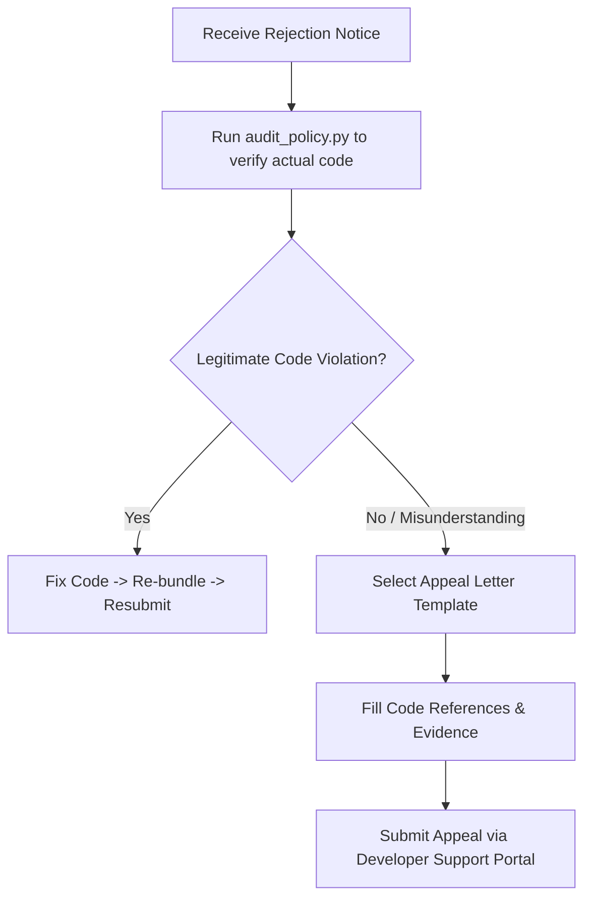

# Chrome Web Store Policy Compliance Checker (`chrome-web-store-policy-checker`)

An automated compliance auditing and rejection-prevention engine for Chrome Extension Manifest V3 projects. It enforces Google's latest **Chrome Web Store Developer Program Policies**, prevents review rejections, generates dashboard-ready permission justifications, and provides standardized appeal letter templates for mistaken review flags.

> [!IMPORTANT]
> Google Chrome Web Store review bots and human review teams enforce **Zero Tolerance** on Remote Code Execution (RCE), undocumented host permissions, and broad multi-purpose feature bundling. A single unbundled CDN script or an unreferenced permission in `manifest.json` will result in immediate rejection or store takedown.

---

## Table of Contents

| Section | Topic | Type |
| :--- | :--- | :--- |
| 1 | 2026 Chrome Web Store Policy Landscape | Policy Overview |
| 2 | The 5-Pillar Compliance Checklist | Comprehensive Audit Checklist |
| 3 | 15-Permission Master Justification Reference Dictionary | Developer Dashboard Copy-Paste |
| 4 | Rejection Appeal Protocol & Formal Letter Templates | Dispute Resolution & Templates |
| 5 | Automation Tooling (`audit_policy.py` & `generate_justifications.py`) | Python CLI Engine |
| 6 | Common Rejection Triggers & Root-Cause Matrix | Failure Prevention |
| 7 | Pre-Submission Decision Tree | Flowchart |

---

## 1. 2026 Chrome Web Store Policy Landscape

All Chrome extensions submitted or updated must strictly comply with modern platform standards:

1. **Manifest V3 Exclusivity**: Manifest V2 is fully deprecated; any extension using `manifest_version: 2` or background pages is rejected automatically.
2. **Zero Remote Code Execution (RCE)**: All JavaScript, WebAssembly, CSS, and configuration files must be physically bundled inside the local extension archive (`dist/`).
3. **Offscreen Documents API**: DOM parsing, clipboard manipulation, or audio playback outside user-visible windows must use the official `chrome.offscreen` API rather than hidden background windows.
4. **Declarative Net Request (DNR)**: Network request interception must use DNR rules rather than legacy blocking webRequest APIs.
5. **AI & LLM Data Transparency**: If an extension integrates LLM APIs (OpenAI, Gemini, Claude, local models), it must explicitly disclose data collection and user prompt transmission in its Privacy Policy and Developer Dashboard declarations.

---

## 2. The 5-Pillar Compliance Checklist

### Pillar 1: Quality & Single Purpose
- **[ ] Single Purpose Principle**
  - An extension must have a single purpose that is narrow and easy to understand.
  - *Audit*: Never bundle disparate toolsets into a single extension (e.g., combining a bookmark manager, a search engine redirector, and a crypto wallet is strictly prohibited).
- **[ ] Settings Override & Search API Compliance**
  - Overriding the New Tab page or Default Search engine must use official Chrome APIs and transparently honor user choice without forceful query hijacking.
- **[ ] User Control & UI Transparency**
  - Never employ deceptive dark patterns, forced clicks, or hidden browser setting modifications.

---

### Pillar 2: User Data & Privacy
- **[ ] Principle of Least Privilege**
  - Request only the absolute minimum permissions (`permissions` and `host_permissions`) necessary for core functionality.
  - *Audit*: Eliminate broad wildcards like `"<all_urls>"` or `"*://*/*"` unless the extension is a universal DOM inspection or styling tool that genuinely operates across the entire web.
- **[ ] Data Minimization & Developer Justifications**
  - Do not collect personal identifiable information (PII), browsing history, or cookies unnecessarily.
  - *Audit*: Prepare clear, concise justification statements for every requested permission.
- **[ ] Privacy Policy Hosting & Scope**
  - If handling user data or sensitive permissions, host a publicly accessible Privacy Policy URL (e.g., GitHub Pages or custom domain) detailing collection scope and retention.
- **[ ] Limited Use Certification**
  - Certify in the Developer Dashboard that user data is never sold, transferred for creditworthiness, or used for personalized advertising.

---

### Pillar 3: Product Integrity & Security
- **[ ] Strict Ban on Remote Code Execution (RCE)**
  - No `eval()`, `new Function()`, `document.write()`, dynamic script tag injection, or `importScripts('http...')`.
  - All third-party libraries (Google Analytics, Firebase, Sentry, Tailwind CDN) must be packaged locally inside the release bundle.
- **[ ] Secure Communication (HTTPS Only)**
  - All external network requests must use `HTTPS`. Insecure `http://` calls are blocked.
- **[ ] XSS & DOM Injection Protection**
  - Sanitize all dynamic HTML insertions. Avoid raw `.innerHTML` or `dangerouslySetInnerHTML` assignments.

---

### Pillar 4: Spam, Intellectual Property & Impersonation
- **[ ] No Duplicative Content**
  - Do not publish multiple extensions with virtually identical functionality differing only in title or metadata.
- **[ ] Keyword Stuffing Prohibition**
  - Do not stuff non-relevant search terms into the title or description for SEO manipulation.
- **[ ] Trademark & Brand Guidelines**
  - Do not prefix extension names with protected trademarks (e.g., *"Google Chrome Quick Tab"* is prohibited; *"Quick Tab for Google Chrome"* or *"Quick Tab"* is permitted).

---

### Pillar 5: Manifest V3 & Modern APIs
- **[ ] Background Service Worker Persistence Safety**
  - Register all event listeners (`chrome.runtime.onMessage`, `chrome.storage.onChanged`) synchronously at the top level of the service worker script to avoid missing events during idle sleep-wake cycles.
- **[ ] Declarative Net Request Quotas**
  - Keep dynamic and session rules within Chrome DNR quotas (typically 30,000 dynamic rules).

---

## 3. 15-Permission Master Justification Reference Dictionary

Use these pre-approved justification templates when filling out the **Privacy practices** tab in the Chrome Web Store Developer Dashboard:

| Permission | Pre-Approved Developer Justification Statement |
| :--- | :--- |
| `storage` | *"Used solely to persist user settings, local configurations, and application state locally on the user's device with zero external telemetry transmission."* |
| `tabs` | *"Required to detect current active tab URLs for domain-specific automation and to coordinate content script messaging strictly within user-initiated actions."* |
| `activeTab` | *"Used to temporarily interact with the active tab when the user explicitly clicks the extension action icon, enabling interactive features without requiring broad host permissions."* |
| `alarms` | *"Used to schedule periodic background sync tasks, routine cache cleanup, and reminders without keeping the service worker continuously running in memory."* |
| `contextMenus` | *"Used to add dedicated right-click context menu options for quick access to extension features directly from web pages."* |
| `notifications` | *"Used to display timely desktop notifications to the user upon task completion, timer events, or important background status updates."* |
| `scripting` | *"Required to programmatically inject scoped stylesheet rules and content script modules into permitted domains strictly based on user interaction."* |
| `cookies` | *"Required to read session authentication state strictly for the permitted domain to verify user login status seamlessly."* |
| `declarativeNetRequest` | *"Used to modify request headers and block tracking scripts locally using privacy-preserving Declarative Net Request rules."* |
| `offscreen` | *"Used to parse DOM content and manage audio playback in a sandboxed offscreen document in compliance with Manifest V3 service worker limitations."* |
| `sidePanel` | *"Required to open the extension interface inside Chrome's dedicated browser side panel for an unobtrusive side-by-side workflow."* |
| `identity` | *"Used to facilitate secure OAuth2 user authentication and token retrieval with third-party cloud services."* |
| `webNavigation` | *"Used to monitor page navigation lifecycle events to re-initialize extension UI states on dynamic single-page applications (SPAs)."* |
| `bookmarks` | *"Required to organize and manage browser bookmarks based on direct user commands."* |
| `history` | *"Used strictly to search and display recent relevant history items inside the extension popup UI with zero external tracking."* |

---

## 4. Rejection Appeal Protocol & Formal Letter Templates

If your extension is rejected by the automated review system or an ambiguous human review decision, follow this standard dispute protocol:



### Template A: Appeal for Misunderstood Single Purpose
```markdown
Subject: Appeal for Rejection - [Extension Name] ([Extension ID]) - Single Purpose Compliance

Dear Chrome Web Store Review Team,

Thank you for your review and feedback regarding our extension "[Extension Name]" (ID: [Extension ID]).

We received a notice citing a potential violation of the "Single Purpose" policy. We would like to respectfully clarify the architectural focus of our extension:

1. Core Single Purpose:
The sole objective of [Extension Name] is to [State exact single purpose, e.g., provide a local markdown note-taking scratchpad in the browser side panel].

2. Feature Clarification:
The features highlighted in the review notice ([Feature A] and [Feature B]) are not separate utilities; rather, they are direct sub-components strictly required to deliver the core functionality:
- [Feature A]: Provides local export formatting for user notes.
- [Feature B]: Persists user styling preferences locally via chrome.storage.local.

3. Minimal Permissions Scope:
Our manifest requests only [List permissions, e.g., storage, sidePanel], each directly serving this single user journey. Zero remote code or third-party ad telemetry is executed.

We have attached a short video walkthrough demonstrating the unified user flow. We kindly request a re-examination of our submission.

Sincerely,
[Developer / Team Name]
[Contact Email]
```

### Template B: Appeal for Broad Host Permissions / Least Privilege
```markdown
Subject: Clarification on Host Permissions - [Extension Name] ([Extension ID])

Dear Chrome Web Store Review Team,

We are writing in response to the review notice regarding the host permissions requested by "[Extension Name]" (ID: [Extension ID]).

We would like to explain the technical rationale behind the requested host permission (`[Host Pattern, e.g., *://*.github.com/*]`):

1. Technical Necessity:
[Extension Name] operates as a developer companion that enhances code reviews on GitHub pull request pages. The content script must inject UI badges directly onto repository diff tables.

2. Strict Scope Boundary:
We do not request `<all_urls>`. The permission is strictly scoped to `*://*.github.com/*`. No user credentials, cookies, or non-public repository data are collected or transferred.

3. Local Execution:
All stylesheet manipulation and DOM rendering occur 100% locally within the browser bundle.

We hope this clarifies the necessity of the requested permission. Thank you for your time and guidance.

Sincerely,
[Developer / Team Name]
```

---

## 5. Automation Tooling (`audit_policy.py` & `generate_justifications.py`)

### 1) Automated Policy Audit (`audit_policy.py`)
Scans `manifest.json` and all source code for RCE vulnerabilities, unencrypted endpoints, and unused permissions:

```bash
# Terminal colored audit summary
python scripts/audit_policy.py --workspace .

# Generate Markdown Audit Report
python scripts/audit_policy.py --workspace . --format markdown --output STORE_AUDIT.md

# Output JSON for CI/CD pipeline gates
python scripts/audit_policy.py --workspace . --format json
```

### 2) Generate Store Permission Justifications (`generate_justifications.py`)
Generates high-compliance justification statements formatted for the Chrome Web Store Developer Dashboard:

```bash
# Generate dashboard-ready justification document
python scripts/generate_justifications.py --manifest ./manifest.json --name "My Extension" --output JUSTIFICATIONS.md
```

---

## 6. Common Rejection Triggers & Root-Cause Matrix

| Rejection Reason | Root Cause in Codebase | Required Remediation |
| :--- | :--- | :--- |
| **Remote Code Execution (RCE)** | Loading Google Analytics (`gtag.js`) via remote URL | Bundle Google Analytics locally or use Measurement Protocol via `fetch()`. |
| **Excessive Host Permissions** | Requesting `"<all_urls>"` for single-domain tool | Replace `"<all_urls>"` with exact host patterns (e.g., `*://*.github.com/*`). |
| **Unused Declared Permissions** | Declaring `cookies` in manifest without code usage | `audit_policy.py` flags unused permissions; prune from `manifest.json`. |
| **Settings Override Hijack** | New Tab override hijacking default search queries | Use Chrome Search API to honor user's chosen search provider. |
| **Missing Privacy Policy** | Missing data retention disclosure on remote server | Host a Markdown/HTML privacy policy on GitHub Pages detailing data scope. |

---

## 7. Pre-Submission Decision Tree

```
START: Pre-submission audit
  │
  ├─ 1. Run audit_policy.py on workspace
  │   ├─ Issues Found? → Fix RCE, prune unused permissions, re-run audit
  │   └─ Zero Issues   → Proceed to justifications ↓
  │
  ├─ 2. Run generate_justifications.py
  │   └─ Copy generated Markdown statements into Developer Dashboard
  │
  ├─ 3. Verify Privacy Policy URL is live and matches store declarations
  │
  └─ 4. Build clean production package (dist/) and submit for review
```
