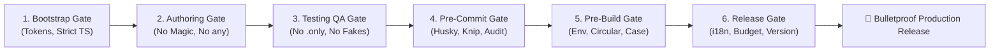

# 🛡️ Universal Guardrail Bootstrap (v2.1.0)

> **End-to-End, Zero-Tolerance SDLC Architecture Guardrail for AI Agents and Developers.**  
> Automatically detects any project's stack and establishes compile-time, test-time, commit-time, pre-build, and release barriers against technical debt.

---

## 🎯 Background & Purpose

Technical debt enters codebases whenever engineering disciplines rely on human memory or soft guidelines. Without automated machine-evaluated locks:
- Magic hex strings and arbitrary dimensions clutter stylesheets.
- `any` types and unhandled promises introduce runtime crashes.
- `it.only` commits accidentally skip 500+ unit tests on CI.
- Circular dependencies cause mysterious `undefined` failures in production.
- Case-sensitivity mismatches pass on Windows/macOS but crash on Linux CI runners.
- Missing translation keys or unbumped version codes cause App Store rejections.

**Universal Guardrail Bootstrap** provides a unified, stack-adaptive defense across all **6 stages of the software engineering lifecycle (SDLC)**.

---

## 🏛️ The 6 Pillars of Quality (Full SDLC Matrix)



| Stage | Scope & Goal | Primary Tooling & Rules | Outcome |
| :--- | :--- | :--- | :--- |
| **Stage 1: Bootstrap Gate** | Design tokens, strict TS, secret isolation | Stack Detector, `tsconfig.json` (`strict: true`), `.gitignore` | Clean Day-0 foundation |
| **Stage 2: Authoring Gate** | Zero magic literals, zero `any`, language key existence | `no-color-literals`, `no-inline-styles`, `no-explicit-any`, `no-floating-promises` | Clean, type-safe components |
| **Stage 3: Testing QA Gate** | No `.only` leaks, no dummy tests, mock isolation | `jest/no-focused-tests`, `jest/expect-expect`, `clearMocks: true`, `coverageThreshold` | 100% reliable regression tests |
| **Stage 4: Pre-Commit Gate** | Reject broken code, secret leaks, dead code | `husky`, `lint-staged`, `knip`, `npm outdated`, `npm audit` | Local git barrier |
| **Stage 5: Pre-Build Gate** | Env validation, circular deps, Linux case, i18n key parity | `prebuild` hook, `dpdm --circular`, Zod env validation, `expo doctor` | Local fail-fast build verification |
| **Stage 6: Release Gate** | 1:1 i18n parity, bundle budget, store versioning | i18n key validator, `size-limit`, store version bump verification | 0 store rejections |

---

## 📦 Unified CLI Commands & `package.json` Blueprint

Integrate these standardized commands into your repository's `package.json`:

```json
{
  "scripts": {
    "guardrail:audit": "npm run check:types && npm run check:lint && npm run check:test && npm run prebuild:check",
    "prebuild:check": "npm run check:env && npm run check:circular && npm run check:case && npm run check:i18n && npm run check:doctor && npm run check:types",
    "check:env": "node scripts/validate-env.js",
    "check:circular": "dpdm --circular --warning=false --tree=false src/",
    "check:case": "node scripts/check-case-sensitivity.js",
    "check:i18n": "node scripts/audit-i18n-parity.js",
    "check:doctor": "npx expo doctor",
    "check:types": "tsc --noEmit",
    "check:lint": "eslint --max-warnings=0",
    "check:test": "jest --passWithNoTests",
    "audit:dead-code": "knip",
    "audit:packages": "npm outdated",
    "audit:security": "npm audit --audit-level=high",
    "release:check": "npm run check:i18n && npm run check:version && npm run check:size",
    "check:version": "node scripts/check-version-bump.js",
    "check:size": "size-limit"
  }
}
```

---

## ☁️ Remote CI Pipeline Template (`.github/workflows/guardrails.yml`)

```yaml
name: Universal SDLC Guardrails

on:
  push:
    branches: [main, master, develop]
  pull_request:
    branches: [main, master, develop]

jobs:
  audit:
    name: 6-Stage Guardrail Verification
    runs-on: ubuntu-latest
    steps:
      - name: Checkout Code
        uses: actions/checkout@v4
      - name: Setup Node.js
        uses: actions/setup-node@v4
        with:
          node-version: 20
          cache: 'npm'
      - name: Install Dependencies
        run: npm ci
      - name: Run Unified Guardrail Audit
        run: npm run guardrail:audit
      - name: Run Test Suite & Coverage Threshold
        run: npm test -- --coverage --passWithNoTests
```

---

## 🚦 Greenfield vs. Brownfield Protocols

### 🟢 Greenfield (New Repositories)
1. Run `universal-guardrail-bootstrap`.
2. All 6 stages are configured at **`"error"`** severity immediately.
3. Feature implementation starts **only after** all gates pass with 0 errors and 0 warnings.

### 🟡 Brownfield (Existing Repositories with Accumulated Debt)
1. Isolate legacy issues using `lint-staged` to enforce zero-tolerance on **newly created/modified files only**.
2. Run audit to establish a technical debt backlog.
3. Systematically replace literals, circularities, and missing tests domain-by-domain.
4. Elevate global rules to `"error"` once legacy cleanup reaches 100%.

---

## 🚀 How to Trigger with AI Agents

When interacting with Gemini Agent (Antigravity), Claude, or any AI pair-programming assistant, invoke this skill with natural language prompts:

```text
# Primary English Prompts (Default)
"Audit this repository with universal-guardrail-bootstrap."
"Check project guardrails and patch any gaps across all SDLC stages."
"Setup strict linters, pre-commit hooks, testing gates, and pre-build checks."
"Bootstrap code-quality and release guardrails for this project."

# Multilingual / Korean Semantic Support
The agent natively maps conversational intents into this skill, including:
"가드레일 점검해봐" (Audit project guardrails)
"프로젝트 가드레일 확인해줘" (Inspect repository guardrails)
"가드레일부터 깔아줘" (Bootstrap guardrails before coding)
"빌드 전 검사 및 테스트 가드레일 점검해줘" (Run pre-build & test checks)
```

---

## 📁 File Structure

```text
skills/universal-guardrail-bootstrap/
├── SKILL.md       # Machine-readable procedural instructions for AI agents (v2.1.0)
└── README.md      # Human-readable architectural reference and documentation
```

---

## 📜 License
MIT © 2026 Modo Team
