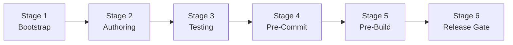

# Universal Guardrail Bootstrap (Full SDLC Edition v2.1.0)

An adaptive, stack-aware architectural guardrail system. Automatically inspects the target project's ecosystem, detects code-quality vulnerabilities across all 6 software development lifecycle (SDLC) stages, and enforces machine-evaluated gatekeeping from Day 0 through store release.

---

## Core Philosophy: "Zero Technical Debt & Machine-Enforced Gatekeeping"

Never rely on developer memory, code reviews, or soft documentation. If a process relies on human discipline, technical debt inevitably enters the codebase. Every project must enforce automated, fail-fast static barriers across all 6 stages of engineering:



---

## Phase 1: Automated Stack & 6-Stage Gap Inspection

When invoked, the agent MUST first inspect `package.json`, lockfiles, and configuration files to determine the technology stack and audit all 6 stages.

### 1. Stack Detection Matrix
- **Mobile (React Native / Expo)**: `react-native`, `expo` in dependencies
- **Web Frontend (Next.js / Vite / React)**: `next`, `react-dom`, `vite`
- **Web Frontend (Vue / Nuxt)**: `vue`, `nuxt`
- **Backend (Node.js / TypeScript)**: `express`, `fastify`, `@nestjs/core`, or standalone Node

### 2. The 6-Stage Gap Audit Checklist
The agent must verify whether the project satisfies all 6 stages:
1. **Stage 1: Project Bootstrap & Foundation Gate**: Are design tokens (`colors.ts`, `spacing.ts`) established? Is TypeScript strict? Are secrets blocked in `.gitignore`?
2. **Stage 2: Code Authoring & Styling Gate**: Are raw colors (#HEX), magic dimensions, inline style objects, `any` types, and unhandled promises blocked at compile time?
3. **Stage 3: Automated Testing & QA Gate**: Are focused tests (`it.only`), assertion-less dummy tests, mock leaks, and timer flakiness prevented?
4. **Stage 4: Version Control & Pre-Commit Gate**: Does a commit hook (Husky + lint-staged) reject invalid commits, secret leaks, and dead code/dependencies?
5. **Stage 5: Pre-Build & Bundling Gate**: Does an automated `prebuild` pipeline verify environment schemas, circular dependencies, Linux case-sensitivity, i18n parity, and native SDK health?
6. **Stage 6: Release & Store Packaging Gate**: Is i18n parity verified (100% key parity)? Is the bundle size budget enforced? Are store version numbers (`versionCode`, `buildNumber`) incremented?

---

## Phase 2: Greenfield vs. Brownfield Execution Strategy

### Mode A: Greenfield (New Projects)
- **Zero-Tolerance Day 0**: All rules are set to `"error"`.
- **Pre-requisite Lock**: No feature, screen, or endpoint code may be generated until all 6 stages achieve 0 errors and 0 warnings.

### Mode B: Brownfield (Existing / Legacy Codebases)
- **Staged Containment**: Do not break the entire build on Day 1 if legacy violations exist.
- **Changed-Files Gating**: Configure `lint-staged` to enforce strict `error` levels on newly created or modified files.
- **Baseline Migration**: Catalog existing violations into tracked issues, then migrate domain-by-domain until full 100% compliance is reached.

---

## Phase 3: Detailed 6-Stage Implementation Blueprints

### Stage 1: Project Bootstrap & Foundation Gate
- Enforce strict TypeScript compiler options in `tsconfig.json`:
  ```json
  {
    "compilerOptions": {
      "strict": true,
      "noImplicitAny": true,
      "strictNullChecks": true,
      "exactOptionalPropertyTypes": true
    }
  }
  ```
- Ensure `.gitignore` covers `.env*`, `*.pem`, `credentials.json`, and platform build artifacts.
- Create design token baselines (`constants/colors.ts`, `constants/spacing.ts`) prior to any UI code.

### Stage 2: Code Authoring & Styling Gate
- **i18n Language Key Existence Gate**:
  - Whenever `t('xxx.yyy')` is used, the key MUST exist in all supported locale JSON files.
  - Require type-safe translation keys (via TypeScript resource augmentation) or run pre-commit key existence scanning.
- **Mobile (React Native / Expo)**:
  ```javascript
  'react-native/no-color-literals': 'error',          // Ban #HEX or rgb(); must use tokens
  'react-native/no-inline-styles': 'error',           // Ban inline style objects (prevents GC churn)
  'react-native/no-raw-text': 'error',                // Ban raw untranslated strings outside <Text>
  'react-native/no-unused-styles': 'error',           // Ban dead StyleSheet entries
  'react-native/no-single-element-style-arrays': 'error', // Ban [styles.a] -> enforce styles.a
  ```
- **Web (Next.js / React / Vue)**:
  - Configure `stylelint-declaration-strict-value` to mandate CSS variables for `color` and `font-size`.
  - Disallow arbitrary Tailwind escape hatches (e.g. `bg-[#123456]`, `w-[347px]`).
- **All Stacks (Strict Types)**:
  ```javascript
  '@typescript-eslint/no-explicit-any': 'error',
  '@typescript-eslint/no-floating-promises': 'error',
  '@typescript-eslint/no-misused-promises': 'error',
  ```

### Stage 3: Automated Testing & QA Gate
- Configure `eslint-plugin-jest` / `eslint-plugin-testing-library`:
  ```javascript
  'jest/no-focused-tests': 'error',     // Ban it.only / fit (prevents accidental skipping of entire test suite)
  'jest/expect-expect': 'error',        // Ban dummy tests without assertions
  'jest/no-identical-title': 'error',   // Ban duplicate test names
  ```
- In `jest.config.js`:
  ```javascript
  module.exports = {
    clearMocks: true,
    restoreMocks: true,
    resetMocks: true,
    coverageThreshold: {
      global: { branches: 80, functions: 80, lines: 80, statements: 80 }
    }
  };
  ```

### Stage 4: Version Control & Pre-Commit Gate
- Install and configure Husky and lint-staged:
  ```json
  "lint-staged": {
    "*.{ts,tsx,js,jsx}": [
      "eslint --max-warnings=0",
      "tsc --noEmit"
    ]
  }
  ```
- Register audit scripts in `package.json`:
  ```json
  "audit:dead-code": "knip",
  "audit:packages": "npm outdated",
  "audit:security": "npm audit --audit-level=high"
  ```

### Stage 5: Pre-Build & Bundling Gate
Configure an automated, fail-fast prebuild pipeline in `package.json`:
```json
{
  "scripts": {
    "guardrail:audit": "npm run check:types && npm run check:lint && npm run check:test && npm run prebuild:check",
    "prebuild:check": "npm run check:env && npm run check:circular && npm run check:case && npm run check:i18n && npm run check:doctor && npm run check:types",
    "check:env": "node scripts/validate-env.js",
    "check:circular": "dpdm --circular --warning=false --tree=false src/",
    "check:case": "node scripts/check-case-sensitivity.js",
    "check:i18n": "node scripts/audit-i18n-parity.js",
    "check:doctor": "npx expo doctor",
    "check:types": "tsc --noEmit",
    "build": "expo export"
  }
}
```

### Stage 6: Release & Store Packaging Gate
- **i18n Parity Audit**: Script to ensure all language packs have 1:1 identical key parity and that no missing translation keys are referenced in code.
- **Bundle Size Budget (`size-limit`)**: Configure strict maximum bundle byte thresholds to prevent accidental bloated package imports.
- **Store Versioning Gate**: Script to verify that `versionCode` (Android), `buildNumber` (iOS), or SemVer is strictly incremented before initiating store upload pipelines.

---

## Phase 4: Standardized Audit Reporting Protocol

When triggered with audit commands (e.g. "audit guardrails", "check guardrails", or conversational equivalents), the agent MUST evaluate the project and format the response using the following structured matrix:

```markdown
### 🛡️ SDLC 6-Stage Guardrail Audit Report

| Stage | Pillar | Status | Findings & Required Remediation |
| :--- | :--- | :---: | :--- |
| **Stage 1** | Bootstrap & Foundation Gate | [PASS / GAP / FAIL] | Detailed findings and required actions |
| **Stage 2** | Code Authoring & Styling Gate | [PASS / GAP / FAIL] | Detailed findings and required actions |
| **Stage 3** | Automated Testing & QA Gate | [PASS / GAP / FAIL] | Detailed findings and required actions |
| **Stage 4** | Pre-Commit Gating | [PASS / GAP / FAIL] | Detailed findings and required actions |
| **Stage 5** | Pre-Build & Bundling Gate | [PASS / GAP / FAIL] | Detailed findings and required actions |
| **Stage 6** | Release & Store Packaging Gate | [PASS / GAP / FAIL] | Detailed findings and required actions |

**Overall Verdict**: [READY / ACTION REQUIRED / BLOCKED]
```

---

## Phase 5: Remote CI/CD Cloud Barrier Template

To ensure guardrails cannot be bypassed locally via `git commit --no-verify`, include this GitHub Actions workflow at `.github/workflows/guardrails.yml`:

```yaml
name: Universal SDLC Guardrails

on:
  push:
    branches: [main, master, develop]
  pull_request:
    branches: [main, master, develop]

jobs:
  audit:
    name: 6-Stage Guardrail Verification
    runs-on: ubuntu-latest
    steps:
      - name: Checkout Code
        uses: actions/checkout@v4

      - name: Setup Node.js
        uses: actions/setup-node@v4
        with:
          node-version: 20
          cache: 'npm'

      - name: Install Dependencies
        run: npm ci

      - name: Run Unified Guardrail Audit
        run: npm run guardrail:audit

      - name: Run Test Suite & Coverage Threshold
        run: npm test -- --coverage --passWithNoTests
```

---

## Phase 6: Non-Negotiable Gatekeeping Protocol

> [!IMPORTANT]
> **Zero Feature Code Rule**: An AI agent or developer MUST NOT write application feature code, screens, or API endpoints on a repository that fails the 6-Stage Gap Audit. If gaps are found, the agent MUST first propose and implement the corresponding remediation recipe, verify a clean `npm run lint` and `npm test`, and only then proceed with product implementation.
