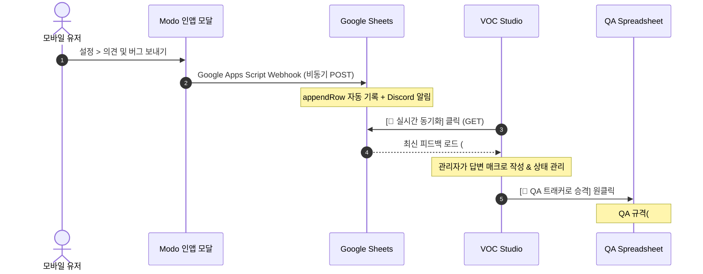

# 📋 Modo QA & VOC 마스터 트래커 표준 운영 가이드 (QA Operation Guide)

본 문서는 **Modo (모도)** 프로젝트의 개발 마일스톤(Phase 1 비공개 테스트 ➔ Phase 2 오픈베타 ➔ Phase 3 정식 출시)과 인앱 유저 피드백(VOC)을 체계적으로 연동 관리하기 위한 **QA & VOC 통합 운영 표준 매뉴얼(SOP)**입니다.

---

## 🏛️ 1. 5대 통합 포털 아키텍처 (5-Portal Architecture)

Modo QA 스튜디오는 역할과 목적에 따라 5개의 독립된 특화 포털로 구성되어 있으며, 모든 포털은 상단 애플 네이티브 글로벌 네비게이션을 통해 상호 직통 이동할 수 있습니다.

```
docs/02_Guides/internal_qa_issue_tracker/
├── index.html                           # 🚀 [Central Hub] macOS Sonoma 런치패드 스타일 5대 포털 관제 허브
├── qa_spreadsheet.html                  # 📑 [Master Spreadsheet] 다차원 필터, 검색, 북마크, 서랍형 인스펙터
├── qa_analytics_dashboard.html          # 📊 [Visual Analytics] 성숙도 골든 커브, 6각 품질 레이더, 코드 핫스팟
├── voc_dashboard.html                   # 💬 [VOC Studio] 듀얼 뷰 스위처, CSAT 만족도 커브, 인입 추이 타임라인, 키워드 클라우드, 구글 시트 13열 라이브 그리드, 매크로 답변
├── google_sheets_voc_setup_guide.html   # 📖 [Setup Guide] Google Apps Script 실시간 웹앱 배포 가이드
├── QA_OPERATION_GUIDE.md                # 📘 [본 문서] 팀 표준 운영 매뉴얼 & 라이프사이클 지침
├── QA_REPORT.md                         # 📄 [Automated Report] 전체 393건 이슈 분석 및 완료 보고서
├── data/                                # 🗄️ [Data Registry] 트랙별 독립 데이터셋
│   ├── qa_manifest.js                   # 트랙 레지스트리 (Phase 1~3, VOC)
│   ├── phase1_closed_testing.js         # Phase 1 비공개 테스트 결함 데이터셋 (389건)
│   ├── phase2_open_beta.js              # Phase 2 오픈베타 데이터셋
│   ├── phase3_v1_1_backlog.js           # Phase 3 정식 출시/백로그 데이터셋
│   └── feedback_manifest.js             # 유저 VOC 피드백 로컬 데이터셋
├── js/                                  # ⚙️ [Core Engines] 공통 엔진
│   ├── qa_engine.js                     # 고성능 렌더링, 필터링, 정렬, 북마크 엔진
│   └── qa_i18n.js                       # 17개 글로벌 언어팩 번역 엔진
└── scripts/                             # 🛠️ [CLI Tools] 자동화 및 유지보수 스크립트
    ├── audit_qa.py                      # IEEE 1044 & ISO 25010 데이터 무결성 검증 Linter
    ├── add_phase.py                     # 신규 개발 마일스톤(Phase) 트랙 자동 생성 CLI
    ├── add_issue.py                     # 터미널 기반 대화형 신규 이슈 등록 CLI
    ├── update_issue.py                  # 이슈 상태/해결 내용 업데이트 CLI
    ├── sync_feedback.py                 # 구글 시트 VOC 실시간 동기화 CLI
    ├── export_report.py                 # Markdown / CSV 종합 보고서 자동 추출 CLI
    └── google_apps_script_template.js   # 구글 시트 웹앱 80줄 표준 연동 스크립트
```

---

## ⏱️ 2. 개발 마일스톤(Phase) 라이프사이클 관리

프로젝트 진행 단계에 따라 트랙을 독립 분할하여 데이터 비대화를 방지하고 이력을 영구 보존합니다.

| 개발 마일스톤 | 트랙 ID | 관리 범위 | 현 상태 |
| :--- | :---: | :--- | :---: |
| **Phase 1: Android 비공개** | `phase1` | 구글 플레이 14일 비공개 테스트 기간 중 발견된 결함 및 테스터 피드백 개선 | **100% 완료** |
| **Phase 2: iOS 테스트 (TestFlight)** | `phase2` | 애플 TestFlight 및 iOS 실기기 환경 특화 결함 및 위젯/권한 관리 | **실시간 운영 중** |
| **Phase 3: 정식 운영 & 로드맵** | `phase3` | 프로덕션 정식 출시(v1.0+) 및 v1.1 이후 백로그 기능/개선 관리 | **실시간 운영 중** |
| **유저 VOC (In-App)** | `feedback` | 인앱 피드백 모달을 통해 구글 시트로 실시간 수집되는 고객 정성적 의견 | **실시간 운영 중** |

### 🚀 신규 Phase 트랙 추가 방법 (CLI)
새로운 마일스톤(예: `phase4`)이 필요할 때는 스크립트 한 줄로 전체 포털에 트랙을 자동 확장합니다:
```bash
python docs/02_Guides/internal_qa_issue_tracker/scripts/add_phase.py --id phase4 --label "Phase 4 고도화"
```

---

## 🏷️ 3. 글로벌 표준 이슈 분류 체계

### (1) 심각도 분류 (IEEE 1044 Standard)
모든 결함은 영향도에 따라 5단계 심각도로 엄격히 분류합니다:

| 심각도 | 명칭 | 정의 및 조치 기준 |
| :---: | :--- | :--- |
| **S1** | 🚨 **Blocker** | 앱 비정상 종료(Crash), 데이터 유실, 무한 루프 등 출시가 원천 불가능한 치명적 결함 |
| **S2** | 🔥 **Critical** | 핵심 기능(작성/저장/인증) 마비, 심각한 성능 저하(프리징), 결제/IAP 오류 |
| **S3** | ⚡ **Major** | 주요 기능 오작동, 레이아웃 깨짐, 동기화 실패 등 회피 경로가 존재하는 중요 결함 |
| **S4** | 🌱 **Minor** | UI 패딩/정렬 오차, 오타, 테마 컬러 미세 불일치, 애니메이션 미흡 |
| **S5** | ☕ **Trivial** | 단순 개선 제안, 가독성 향상, 코드 리팩토링 및 주석 정비 |

### (2) 품질 도메인 분류 (ISO/IEC 25010 Standard)
| 도메인 코드 | 카테고리명 | 해당 범위 |
| :---: | :--- | :--- |
| `ui` | 🎨 **UI/UX 디자인** | 컴포넌트 여백, 다크/라이트 테마, 폰트 가독성, 터치 영역, 애니메이션 |
| `core` | ⚙️ **코어 기능성** | 마크다운 파서, 에디터 서식 브릿지, 태그/폴더 분류, 검색 엔진 |
| `reliability` | 🛡️ **시스템 안정성** | 비정상 종료 방어, 널 포인터 가드, 레이스 컨디션 해결, 상태 복원력 |
| `perf` | ⚡ **성능 & 속도** | 대용량 메모 파싱 속도, FlatList 렌더링 최적화, 메모리 누수 차단 |
| `auth` | 🔐 **보안 & 인증** | 생체 인증, Google OAuth (offlineAccess), 데이터베이스 암호화, 토큰 갱신 |
| `monetization`| 💰 **수익화/IAP** | 광고 로드, 인앱 결제 영수증 검증, Pro 기능 게이트웨이, 쿨다운 타이머 |
| `media` | 🎙️ **미디어/오디오** | 음성 녹음 DSP 필터링, 타건 효과음, OCR 텍스트 추출, 이미지 캐시 |
| `db` | 💾 **데이터 & 저장소** | SQLite 스키마 마이그레이션, WAL 모드, 자동 백업/복원 무결성 |

---

## 🔄 4. 유저 VOC ➔ 내부 QA 승격 파이프라인 (Escalation Workflow)



1. **인앱 수집**: 유저가 `FeedbackModal.tsx`에서 의견 입력 ➔ 기기 진단 정보와 함께 Google Apps Script로 즉시 전송.
2. **실시간 확인**: 담당자가 `voc_dashboard.html`에서 `[🔄 시트 동기화]`를 눌러 최신 의견 검토.
3. **스마트 답변**: 내장된 6대 매크로 템플릿(버그 접수, 감사, 재현 요청 등)으로 공식 답변을 원클릭 생성 및 관리.
4. **결함 승격**: 기술적 수정이 필요한 안건은 `[🚀 QA 트래커로 승격]`을 클릭 ➔ 표준 QA JSON 스니펫을 복사하여 즉시 Phase 트랙에 등록.

---

## 🛡️ 5. 품질 검증 및 Linter 운영 수칙

코드 수정이나 데이터 추가 직후에는 반드시 다음 3중 검증을 통과해야 배포할 수 있습니다:

1. **데이터 무결성 검증 (Python Linter)**:
   ```bash
   python docs/02_Guides/internal_qa_issue_tracker/scripts/audit_qa.py
   ```
   - ID 중복, 매니페스트 배지 카운트 불일치, 필수 필드(`title`, `problem`, `solution`) 누락 전수 검사.
2. **TypeScript 정적 타입 검사**:
   ```bash
   npx tsc --noEmit
   ```
   - 문법 및 정적 타입 에러 0건 유지.
3. **단위/통합 테스트 스위트**:
   ```bash
   npm test
   ```
   - 71개 테스트 스위트 전건 통과 확인.
4. **종합 보고서 자동 생성**:
   ```bash
   python docs/02_Guides/internal_qa_issue_tracker/scripts/export_report.py
   ```
   - `QA_REPORT.md` 및 CSV 파일 자동 갱신.
